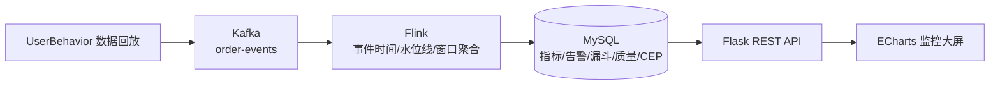

# 电商交易实时流处理与监控预警平台

> 一句话：把淘宝用户行为数据实时回灌进 Kafka，用 Flink 做实时统计与预警，再用大屏可视化。

基于 **Kafka + Flink + MySQL + Flask/ECharts** 的实时数据处理与可视化监控平台。系统回放公开的淘宝用户行为数据集（UserBehavior），
实现实时指标聚合、行为转化漏斗、数据质量监控、CEP 复杂事件预警、可配置告警与实时可视化大屏。

## 功能特性

- **数据回放**：读取 `UserBehavior.csv`，按时间戳加速回放入 Kafka，可配置倍速
- **实时计算**：Flink 事件时间语义 + 水位线 + 10 秒滚动窗口增量聚合
- **指标落库**：品类成交额（GMV）与支付订单数写入 MySQL，采用幂等 upsert
- **行为转化漏斗**：浏览 PV → 加购 Cart → 收藏 Fav → 购买 Buy 计数与转化率
- **数据质量监控**：接收/有效/无效记录数与无效占比
- **CEP 复杂事件预警**：检测同一用户同一商品「加购 → 购买」的序列模式
- **告警规则可配置**：规则存数据库，作业每 30 秒热加载，支持 Webhook 通知
- **可视化大屏**：Flask + ECharts，多页面（总览、品类分析、转化漏斗、数据质量、CEP、规则配置、告警、明细）
- **端到端一致性**：唯一键 + 幂等写入，重算不产生重复

## 系统架构



## 技术栈

| 组件 | 版本 |
|---|---|
| JDK | 17 |
| Apache Flink | 1.20.5 |
| Apache Kafka | 4.3.1（KRaft） |
| MySQL | 8.0 |
| Maven | 3.9 |
| Python | 3.10+（Flask / PyMySQL / kafka-python） |
| 可视化 | Flask + ECharts |

## 目录结构

```
.
├─ flink-job/          Flink 实时作业（Java + Maven）
├─ data-simulator/     数据回放器（replay.py）、样本生成（make_sample.py）
├─ dashboard/          Flask 后端 + ECharts 大屏 + notifier.py
├─ scripts/            一键启动/停止/压测脚本
├─ sql/init.sql        数据库建表脚本
└─ 文档/               运行说明、性能调优说明、版本选型说明
```

## 快速开始

### 1. 前置环境

需要安装 JDK 17、Apache Flink 1.20.5、Apache Kafka 4.3.1、MySQL 8.0、Maven 3.9、Python 3.10+。
脚本会在项目 `env/` 目录或环境变量 `JAVA_HOME / FLINK_HOME / KAFKA_HOME / MYSQL_HOME` 中查找这些组件
（本仓库不包含运行环境，请自行安装并按需修改 `scripts/*.ps1` 中的默认路径）。

安装 Python 依赖：

```bash
pip install flask pymysql kafka-python
```

### 2. 初始化数据库

```bash
mysql -u root -p -e "CREATE DATABASE IF NOT EXISTS bigdata DEFAULT CHARSET utf8mb4;"
mysql -u root -p bigdata < sql/init.sql
```

### 3. 准备数据

将淘宝用户行为数据集 `UserBehavior.csv` 放到 `data-simulator/` 目录，或用环境变量 `DATA_FILE` 指定路径。
仓库自带 `UserBehavior_sample.csv` 用于联调，缺少真实数据时会自动使用它。

### 4. 启动

```powershell
powershell -ExecutionPolicy Bypass -File scripts\start-system.ps1
```

- 大屏：http://localhost:5000
- Flink Web UI：http://localhost:8081

停止：

```powershell
powershell -ExecutionPolicy Bypass -File scripts\stop-all.ps1
```

### 5. 常用环境变量

| 变量 | 说明 | 默认 |
|---|---|---|
| `KAFKA_BOOTSTRAP` | Kafka 地址 | `localhost:9092` |
| `KAFKA_TOPIC` | 主题名 | `order-events` |
| `DATA_FILE` | 数据集路径 | `data-simulator/UserBehavior.csv` |
| `SPEED` | 回放倍速 | `100` |
| `ONLY_BUY` | 是否只回放购买行为 | `0` |
| `MYSQL_PASSWORD` | MySQL 密码 | 请通过环境变量设置 |
| `WEBHOOK_URL` | 告警推送地址（钉钉/企业微信） | 空 |
| `WEBHOOK_TYPE` | 推送类型 dingtalk/wecom/generic | `dingtalk` |

> 说明：代码中的数据库密码为本地开发默认值，正式使用请通过环境变量覆盖。

## 文档

- `文档/系统运行说明.docx` — 环境、启动、数据源、通知配置
- `文档/性能调优与压测对比说明.docx` — 调优前后对比、压测数据、背压分析
- `文档/版本选型说明与答辩问答.docx` — 技术栈选型依据与常见问题

## License

本项目基于 [MIT License](LICENSE) 开源。
